# iClimateAction WP3, Task 3.2: Nature-based Solutions and Ecosystems Demonstrator

Task 3.2 of Work Package 3 of the iClimateAction project, funded by the European Commission and implemented by WMO, GCOS and GEO, assesses the climate change vulnerability of ecosystems in the Maldives, in collaboration with UNU-EHS. The assessment focuses on mangroves. This page presents the Essential Climate Variables (ECVs) compiled for it: sea surface temperature, sea level, sea state, precipitation and near-surface air temperature.

## Summary

| Variable | Source | Period | Unit | Trend per decade |
|---|---|---|---|---|
| [Sea surface temperature](#sea-surface-temperature-esa-cci) | ESA CCI | 1991 to 2023 | °C | **+0.179 °C** |
| [Sea level, absolute dynamic topography](#sea-level-absolute-dynamic-topography-copernicus-marine) | Copernicus Marine | 1993 to 2024 | m | **+0.0388 m** |
| [Sea state, significant wave height](#sea-state-significant-wave-height-esa-cci) | ESA CCI | 1993 to 2023 | m | **-0.0279 m** |
| [Precipitation](#precipitation-chirps-v20) | CHIRPS v2.0 | 1981 to 2025 | mm per year | **-101 mm** |
| [Air temperature, daily mean](#air-temperature-daily-mean-chelsa) | CHELSA | 1993 to 2024 | °C | **+0.225 °C** |
| [Air temperature, daily maximum](#air-temperature-daily-maximum-chelsa) | CHELSA | 1993 to 2024 | °C | **+0.229 °C** |

Trend of the average of the 8 atolls with mangroves, in years where all of them have a value, over the period shown. Bold: significant (p < 0.05).

## How to read the figures

- **Atolls with mangroves:** 8 (Gaafu Dhaalu, Haa Alifu, Haa Dhaalu, Kaafu, Laamu, Lhaviyani, Noonu, Seenu). Mangrove extent: Cerri 2020.
- **Main atolls:** Haa Alifu, Noonu, Haa Dhaalu, Seenu, Lhaviyani. Together they hold 92% of the mangrove area.
- **Dashed line:** linear trend (least squares) of the annual values. A trend is called significant when p < 0.05.

## Sea surface temperature (ESA CCI)

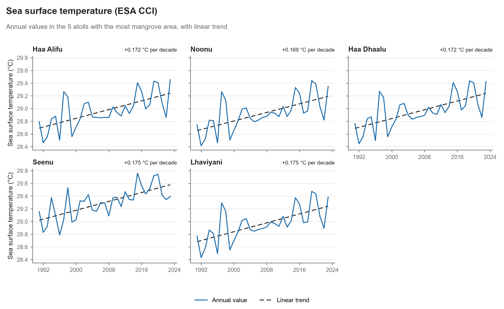

**Figure 1.** Annual values in the 5 atolls with the most mangrove area, with linear trend (dashed) and trend per decade.

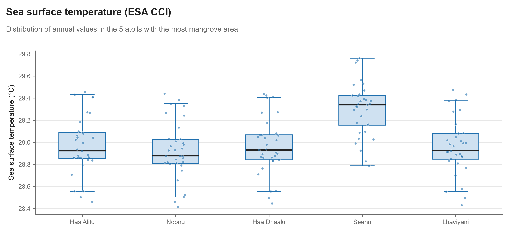

**Figure 2.** Distribution of the annual values in the 5 atolls with the most mangrove area. Box: middle half of the years; line: median; whiskers: up to 1.5 times the box; dots: single years.

**Table 1.** Mean of the annual values and linear trend by atoll, largest mangrove area first. Bold: significant (p < 0.05).

| Atoll | Mangrove area (km²) | Period | Mean (°C) | Trend (°C per decade) | p |
|---|---|---|---|---|---|
| Haa Alifu | 0.339 | 1991 to 2023 | 28.97 | **+0.172** | < 0.001 |
| Noonu | 0.317 | 1991 to 2023 | 28.92 | **+0.169** | < 0.001 |
| Haa Dhaalu | 0.237 | 1991 to 2023 | 28.96 | **+0.172** | < 0.001 |
| Seenu | 0.158 | 1991 to 2023 | 29.30 | **+0.175** | < 0.001 |
| Lhaviyani | 0.104 | 1991 to 2023 | 28.96 | **+0.175** | < 0.001 |
| Laamu | 0.053 | 1991 to 2023 | 29.22 | **+0.196** | < 0.001 |
| Gaafu Dhaalu | 0.035 | 1991 to 2023 | 29.26 | **+0.180** | < 0.001 |
| Kaafu | 0.009 | 1991 to 2023 | 28.99 | **+0.194** | < 0.001 |

## Sea level, absolute dynamic topography (Copernicus Marine)

**Figure 3.** Annual values in the 5 atolls with the most mangrove area, with linear trend (dashed) and trend per decade.

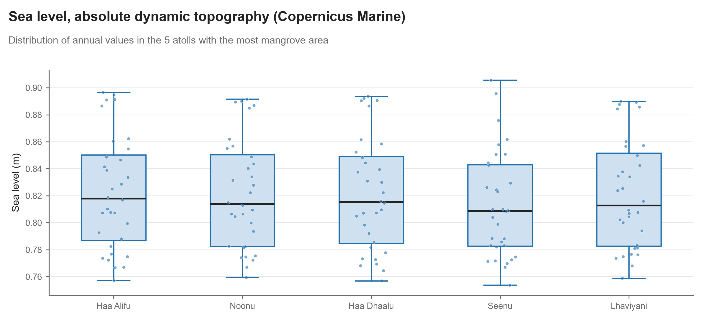

**Figure 4.** Distribution of the annual values in the 5 atolls with the most mangrove area. Box: middle half of the years; line: median; whiskers: up to 1.5 times the box; dots: single years.

<table><tr>
<td width="50%" valign="top">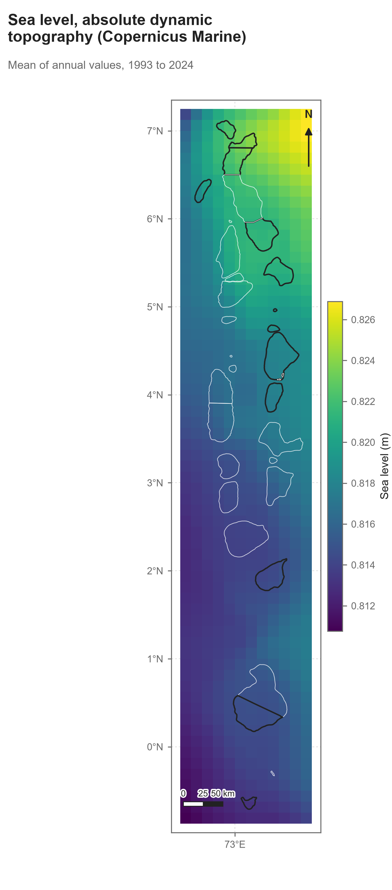 <b>Figure 5.</b> Mean of the annual values for the whole Maldives (1993 to 2024). Outlines: atolls; dark outline: atolls with mangroves. The colour scale runs from the lowest to the highest value in the map.</td>
<td width="50%" valign="top">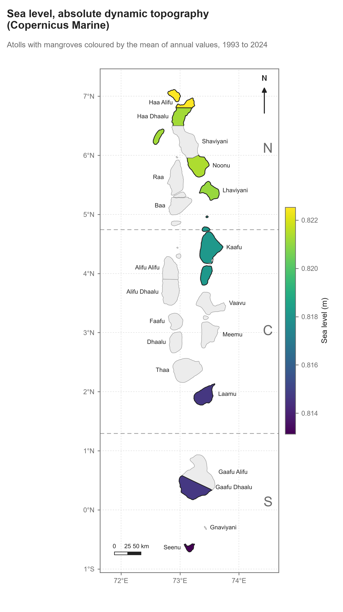 <b>Figure 6.</b> Mean of the annual values by atoll (1993 to 2024). Colour: atolls with mangroves; grey: atolls without mangroves in the Cerri 2020 extent. The colour scale runs from the lowest to the highest atoll mean.</td>
</tr></table>

**Table 2.** Mean of the annual values and linear trend by atoll, largest mangrove area first. Bold: significant (p < 0.05).

| Atoll | Mangrove area (km²) | Period | Mean (m) | Trend (m per decade) | p |
|---|---|---|---|---|---|
| Haa Alifu | 0.339 | 1993 to 2024 | 0.823 | **+0.0406** | < 0.001 |
| Noonu | 0.317 | 1993 to 2024 | 0.821 | **+0.0391** | < 0.001 |
| Haa Dhaalu | 0.237 | 1993 to 2024 | 0.821 | **+0.0404** | < 0.001 |
| Seenu | 0.158 | 1993 to 2024 | 0.813 | **+0.0367** | < 0.001 |
| Lhaviyani | 0.104 | 1993 to 2024 | 0.821 | **+0.0386** | < 0.001 |
| Laamu | 0.053 | 1993 to 2024 | 0.815 | **+0.0381** | < 0.001 |
| Gaafu Dhaalu | 0.035 | 1993 to 2024 | 0.815 | **+0.0376** | < 0.001 |
| Kaafu | 0.009 | 1993 to 2024 | 0.818 | **+0.0393** | < 0.001 |

## Sea state, significant wave height (ESA CCI)

**Figure 7.** Annual values in the 5 atolls with the most mangrove area, with linear trend (dashed) and trend per decade.

**Figure 8.** Distribution of the annual values in the 5 atolls with the most mangrove area. Box: middle half of the years; line: median; whiskers: up to 1.5 times the box; dots: single years.

**Table 3.** Mean of the annual values and linear trend by atoll, largest mangrove area first. Bold: significant (p < 0.05).

| Atoll | Mangrove area (km²) | Period | Mean (m) | Trend (m per decade) | p |
|---|---|---|---|---|---|
| Haa Alifu | 0.339 | 1993 to 2023 | 1.052 | **-0.0453** | < 0.001 |
| Noonu | 0.317 | 1993 to 2023 | 0.827 | **-0.0815** | < 0.001 |
| Haa Dhaalu | 0.237 | 1993 to 2023 | 0.992 | **-0.0528** | < 0.001 |
| Seenu | 0.158 | 1993 to 2023 | 1.339 | **+0.0426** | < 0.001 |
| Lhaviyani | 0.104 | 1993 to 2023 | 0.803 | +0.0101 | 0.226 |
| Laamu | 0.053 | 1992 to 2023 | 1.205 | -0.0247 | 0.071 |
| Gaafu Dhaalu | 0.035 | 1992 to 2023 | 1.199 | **-0.0458** | 0.008 |
| Kaafu | 0.009 | 1992 to 2023 | 0.802 | **-0.0321** | 0.001 |

## Precipitation (CHIRPS v2.0)

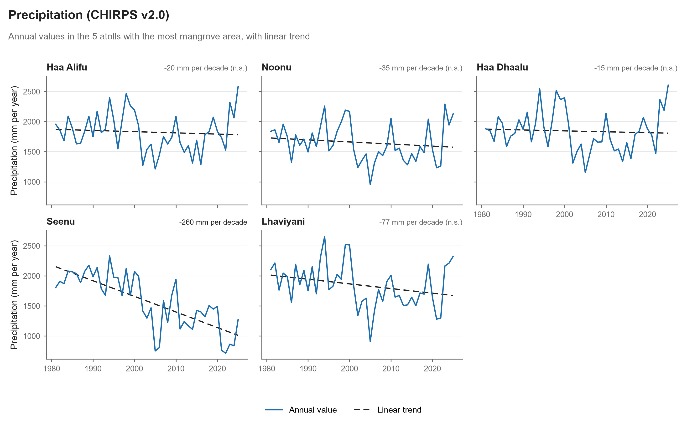

**Figure 9.** Annual values in the 5 atolls with the most mangrove area, with linear trend (dashed) and trend per decade.

**Figure 10.** Distribution of the annual values in the 5 atolls with the most mangrove area. Box: middle half of the years; line: median; whiskers: up to 1.5 times the box; dots: single years.

**Table 4.** Mean of the annual values and linear trend by atoll, largest mangrove area first. Bold: significant (p < 0.05).

| Atoll | Mangrove area (km²) | Period | Mean (mm per year) | Trend (mm per decade) | p |
|---|---|---|---|---|---|
| Haa Alifu | 0.339 | 1981 to 2025 | 1828 | -20 | 0.586 |
| Noonu | 0.317 | 1981 to 2025 | 1652 | -35 | 0.340 |
| Haa Dhaalu | 0.237 | 1981 to 2025 | 1842 | -15 | 0.706 |
| Seenu | 0.158 | 1981 to 2025 | 1582 | **-260** | < 0.001 |
| Lhaviyani | 0.104 | 1981 to 2025 | 1844 | -77 | 0.063 |
| Laamu | 0.053 | 1981 to 2025 | 1211 | **-116** | < 0.001 |
| Gaafu Dhaalu | 0.035 | 1981 to 2025 | 1226 | **-191** | < 0.001 |
| Kaafu | 0.009 | 1981 to 2025 | 1659 | **-95** | 0.017 |

## Air temperature, daily mean (CHELSA)

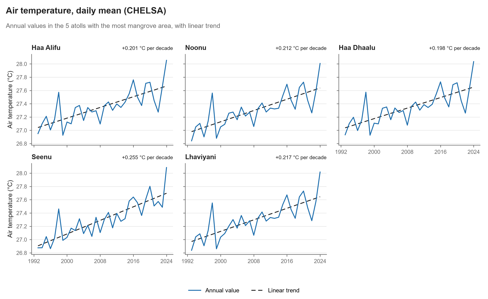

**Figure 11.** Annual values in the 5 atolls with the most mangrove area, with linear trend (dashed) and trend per decade.

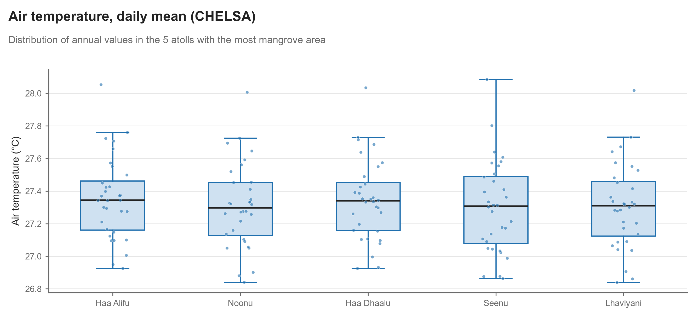

**Figure 12.** Distribution of the annual values in the 5 atolls with the most mangrove area. Box: middle half of the years; line: median; whiskers: up to 1.5 times the box; dots: single years.

<table><tr>
<td width="50%" valign="top">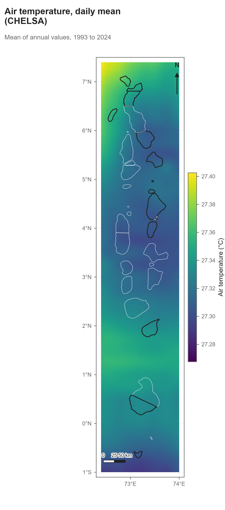 <b>Figure 13.</b> Mean of the annual values for the whole Maldives (1993 to 2024). Outlines: atolls; dark outline: atolls with mangroves. The colour scale runs from the lowest to the highest value in the map.</td>
<td width="50%" valign="top">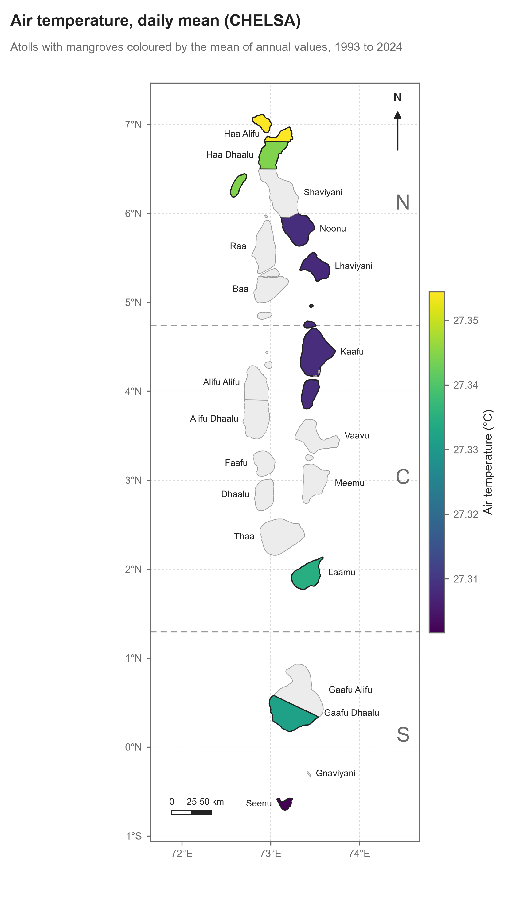 <b>Figure 14.</b> Mean of the annual values by atoll (1993 to 2024). Colour: atolls with mangroves; grey: atolls without mangroves in the Cerri 2020 extent. The colour scale runs from the lowest to the highest atoll mean.</td>
</tr></table>

**Table 5.** Mean of the annual values and linear trend by atoll, largest mangrove area first. Bold: significant (p < 0.05).

| Atoll | Mangrove area (km²) | Period | Mean (°C) | Trend (°C per decade) | p |
|---|---|---|---|---|---|
| Haa Alifu | 0.339 | 1993 to 2024 | 27.35 | **+0.201** | < 0.001 |
| Noonu | 0.317 | 1993 to 2024 | 27.31 | **+0.212** | < 0.001 |
| Haa Dhaalu | 0.237 | 1993 to 2024 | 27.34 | **+0.198** | < 0.001 |
| Seenu | 0.158 | 1993 to 2024 | 27.30 | **+0.255** | < 0.001 |
| Lhaviyani | 0.104 | 1993 to 2024 | 27.31 | **+0.217** | < 0.001 |
| Laamu | 0.053 | 1993 to 2024 | 27.33 | **+0.251** | < 0.001 |
| Gaafu Dhaalu | 0.035 | 1993 to 2024 | 27.33 | **+0.248** | < 0.001 |
| Kaafu | 0.009 | 1993 to 2024 | 27.31 | **+0.219** | < 0.001 |

## Air temperature, daily maximum (CHELSA)

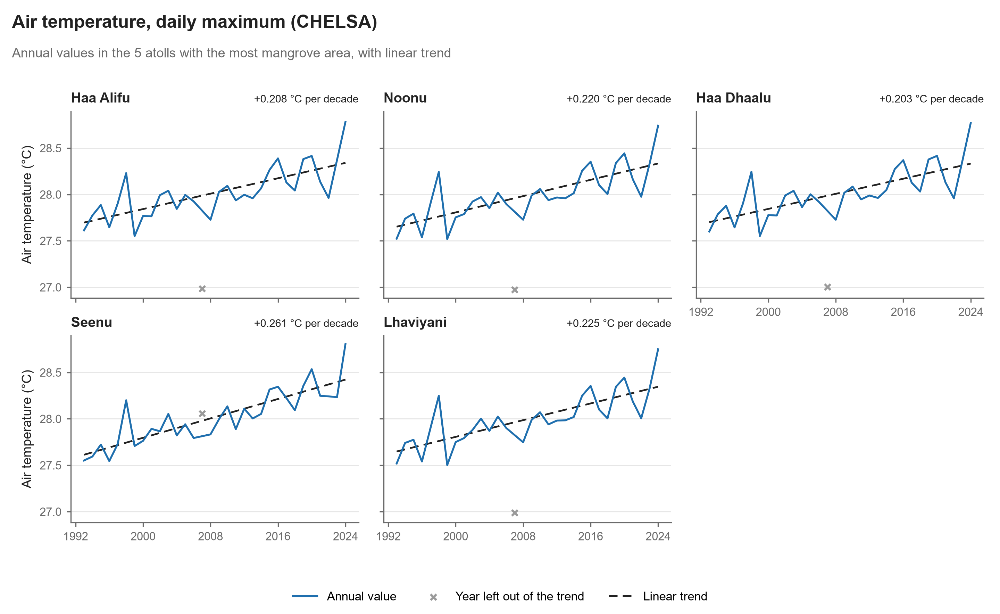

**Figure 15.** Annual values in the 5 atolls with the most mangrove area, with linear trend (dashed) and trend per decade.

**Figure 16.** Distribution of the annual values in the 5 atolls with the most mangrove area. Box: middle half of the years; line: median; whiskers: up to 1.5 times the box; dots: single years.

<table><tr>
<td width="50%" valign="top">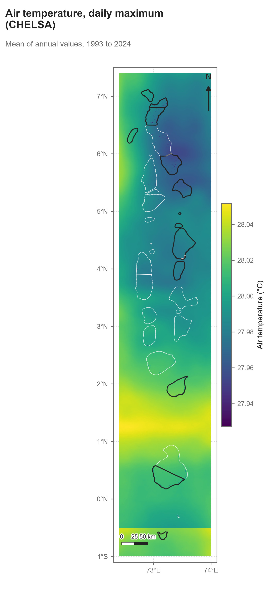 <b>Figure 17.</b> Mean of the annual values for the whole Maldives (1993 to 2024). Outlines: atolls; dark outline: atolls with mangroves. The colour scale runs from the lowest to the highest value in the map.</td>
<td width="50%" valign="top">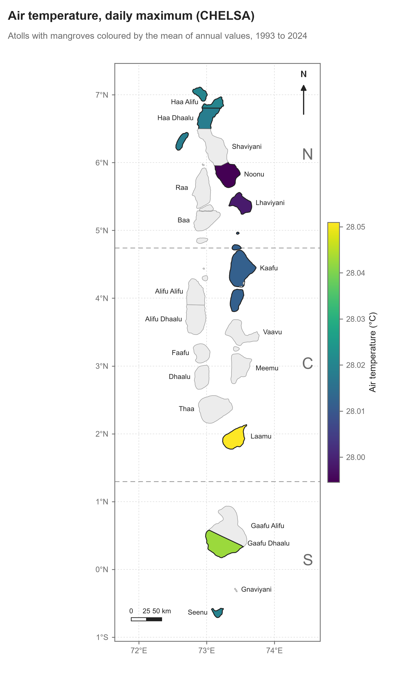 <b>Figure 18.</b> Mean of the annual values by atoll (1993 to 2024). Colour: atolls with mangroves; grey: atolls without mangroves in the Cerri 2020 extent. The colour scale runs from the lowest to the highest atoll mean.</td>
</tr></table>

**Table 6.** Mean of the annual values and linear trend by atoll, largest mangrove area first. Bold: significant (p < 0.05).

| Atoll | Mangrove area (km²) | Period | Mean (°C) | Trend (°C per decade) | p |
|---|---|---|---|---|---|
| Haa Alifu | 0.339 | 1993 to 2024 | 28.02 | **+0.208** | < 0.001 |
| Noonu | 0.317 | 1993 to 2024 | 27.99 | **+0.220** | < 0.001 |
| Haa Dhaalu | 0.237 | 1993 to 2024 | 28.02 | **+0.203** | < 0.001 |
| Seenu | 0.158 | 1993 to 2024 | 28.02 | **+0.261** | < 0.001 |
| Lhaviyani | 0.104 | 1993 to 2024 | 28.00 | **+0.225** | < 0.001 |
| Laamu | 0.053 | 1993 to 2024 | 28.05 | **+0.247** | < 0.001 |
| Gaafu Dhaalu | 0.035 | 1993 to 2024 | 28.04 | **+0.248** | < 0.001 |
| Kaafu | 0.009 | 1993 to 2024 | 28.01 | **+0.223** | < 0.001 |

Years left out of the trends and the means (possible data problem): 2007.
