# Essential climate variables (ECV)

## How to read the figures

- **Atolls with mangroves:** 8 (Gaafu Dhaalu, Haa Alifu, Haa Dhaalu, Kaafu, Laamu, Lhaviyani, Noonu, Seenu). Mangrove extent: Cerri 2020.
- **Main atolls:** Haa Alifu, Noonu, Haa Dhaalu, Seenu, Lhaviyani. Together they hold 92% of the mangrove area.
- **Mean:** simple mean of the atolls with mangroves, in years where all of them have a value.
- **Dashed line:** linear trend (least squares) of the annual values. A trend is called significant when p < 0.05.

## Summary

| ECV | Source file | Period of the mean | Unit | Trend of the mean (per decade) | p |
|---|---|---|---|---|---|
| [Sea surface temperature (ESA CCI)](#sea-surface-temperature-esa-cci) | sst_esacci_maldives_1991-2024.xlsx | 1991 to 2023 | °C | **+0.179 °C** | < 0.001 |
| [Sea level, absolute dynamic topography (Copernicus Marine)](#sea-level-absolute-dynamic-topography-copernicus-marine) | SeaLevel_CopernicusMarine_1993_2024_by_atoll.xlsx | 1993 to 2024 | m | **+0.0388 m** | < 0.001 |
| [Sea state, significant wave height (ESA CCI)](#sea-state-significant-wave-height-esa-cci) | sea_state_maldives_1991-2023.xlsx | 1993 to 2023 | m | **-0.0279 m** | 0.002 |
| [Precipitation (IMERG)](#precipitation-imerg) | Precipitation_IMERGv07_200101_202412.xlsx | 2001 to 2024 | mm per year | -27.8 mm | 0.633 |
| [Air temperature, daily mean (CHELSA)](#air-temperature-daily-mean-chelsa) | tas_chelsa_maldives_1993-2024.xlsx | 1993 to 2024 | °C | **+0.225 °C** | < 0.001 |
| [Air temperature, daily maximum (CHELSA)](#air-temperature-daily-maximum-chelsa) | tasmax_chelsa_maldives_1993-2024.xlsx | 1993 to 2024 | °C | **+0.229 °C** | < 0.001 |

## Sea surface temperature (ESA CCI)

**Figure 1.** Sea surface temperature (ESA CCI): annual values in the 5 atolls with the most mangrove area, with linear trend (dashed) and trend per decade.

**Figure 2.** Sea surface temperature (ESA CCI): distribution of the annual values in the 5 atolls with the most mangrove area. Box: middle half of the years; line: median; whiskers: up to 1.5 times the box; dots: single years.

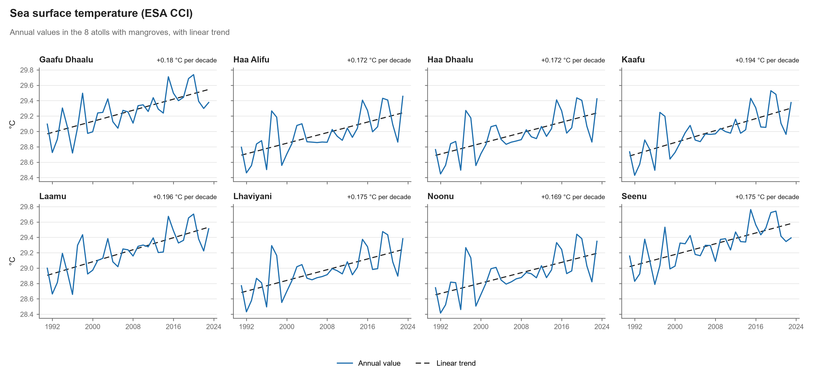

**Figure 3.** Sea surface temperature (ESA CCI): annual values in all 8 atolls with mangroves, with linear trend (dashed) and trend per decade.

**Table 1.** Sea surface temperature (ESA CCI): mean and linear trend by atoll, largest mangrove area first. Bold: significant (p < 0.05).

| Atoll | Mangrove area (km2) | Period | Mean (°C) | Trend (°C per decade) | p |
|---|---|---|---|---|---|
| Haa Alifu | 0.339 | 1991 to 2023 | 28.97 | **+0.172** | < 0.001 |
| Noonu | 0.317 | 1991 to 2023 | 28.92 | **+0.169** | < 0.001 |
| Haa Dhaalu | 0.237 | 1991 to 2023 | 28.96 | **+0.172** | < 0.001 |
| Seenu | 0.158 | 1991 to 2023 | 29.3 | **+0.175** | < 0.001 |
| Lhaviyani | 0.104 | 1991 to 2023 | 28.96 | **+0.175** | < 0.001 |
| Laamu | 0.053 | 1991 to 2023 | 29.22 | **+0.196** | < 0.001 |
| Gaafu Dhaalu | 0.035 | 1991 to 2023 | 29.26 | **+0.18** | < 0.001 |
| Kaafu | 0.009 | 1991 to 2023 | 28.99 | **+0.194** | < 0.001 |

## Sea level, absolute dynamic topography (Copernicus Marine)

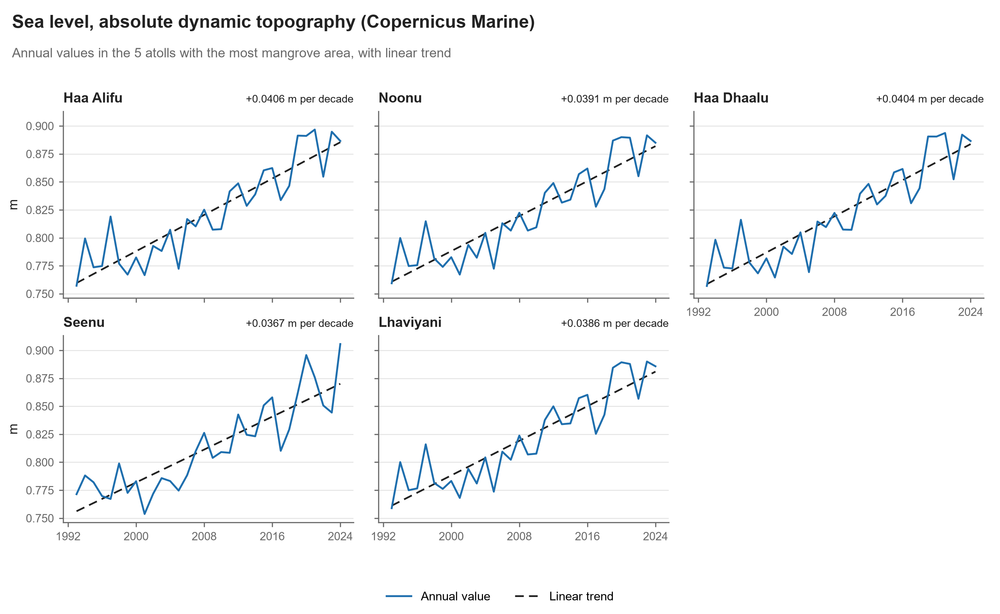

**Figure 4.** Sea level, absolute dynamic topography (Copernicus Marine): annual values in the 5 atolls with the most mangrove area, with linear trend (dashed) and trend per decade.

**Figure 5.** Sea level, absolute dynamic topography (Copernicus Marine): distribution of the annual values in the 5 atolls with the most mangrove area. Box: middle half of the years; line: median; whiskers: up to 1.5 times the box; dots: single years.

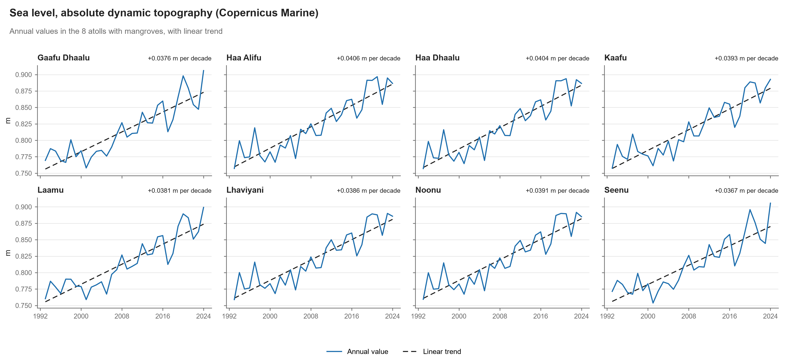

**Figure 6.** Sea level, absolute dynamic topography (Copernicus Marine): annual values in all 8 atolls with mangroves, with linear trend (dashed) and trend per decade.

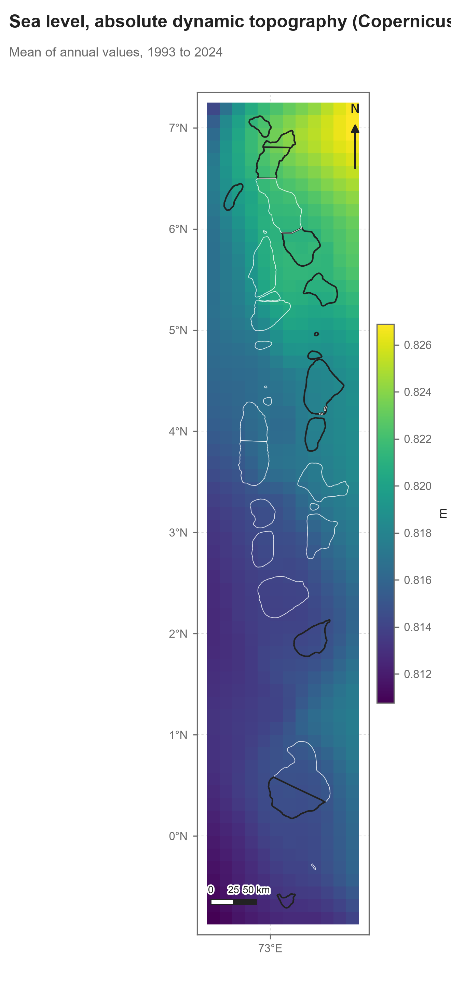

**Figure 7.** Sea level, absolute dynamic topography (Copernicus Marine): mean of the annual values for the whole Maldives (1993 to 2024). Outlines: atolls; dark outline: atolls with mangroves.

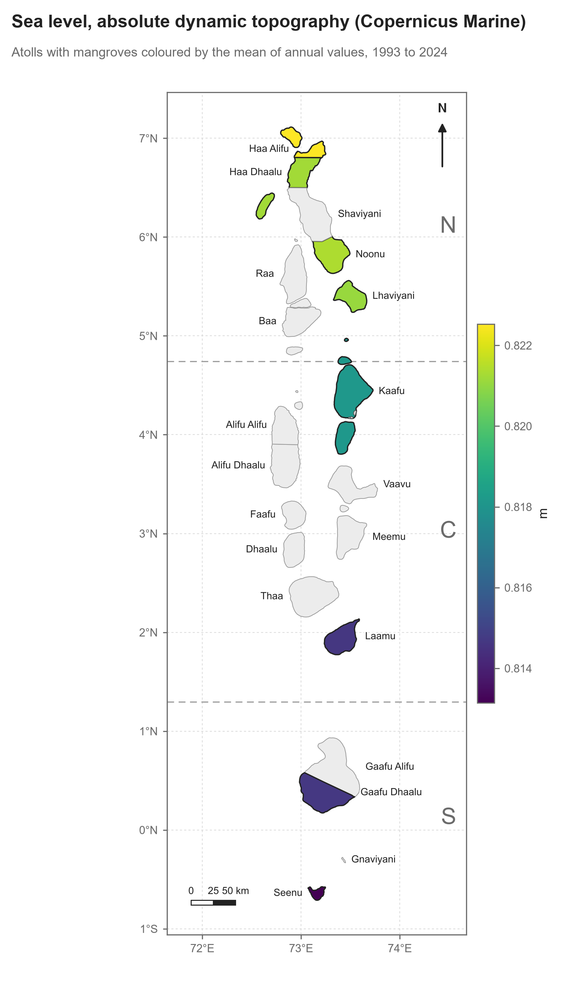

**Figure 8.** Sea level, absolute dynamic topography (Copernicus Marine): mean of the annual values by atoll (1993 to 2024). Colour: atolls with mangroves; grey: atolls without mangroves in the Cerri 2020 extent.

**Table 2.** Sea level, absolute dynamic topography (Copernicus Marine): mean and linear trend by atoll, largest mangrove area first. Bold: significant (p < 0.05).

| Atoll | Mangrove area (km2) | Period | Mean (m) | Trend (m per decade) | p |
|---|---|---|---|---|---|
| Haa Alifu | 0.339 | 1993 to 2024 | 0.8225 | **+0.0406** | < 0.001 |
| Noonu | 0.317 | 1993 to 2024 | 0.8214 | **+0.0391** | < 0.001 |
| Haa Dhaalu | 0.237 | 1993 to 2024 | 0.8212 | **+0.0404** | < 0.001 |
| Seenu | 0.158 | 1993 to 2024 | 0.8131 | **+0.0367** | < 0.001 |
| Lhaviyani | 0.104 | 1993 to 2024 | 0.8211 | **+0.0386** | < 0.001 |
| Laamu | 0.053 | 1993 to 2024 | 0.8146 | **+0.0381** | < 0.001 |
| Gaafu Dhaalu | 0.035 | 1993 to 2024 | 0.8147 | **+0.0376** | < 0.001 |
| Kaafu | 0.009 | 1993 to 2024 | 0.8181 | **+0.0393** | < 0.001 |

## Sea state, significant wave height (ESA CCI)

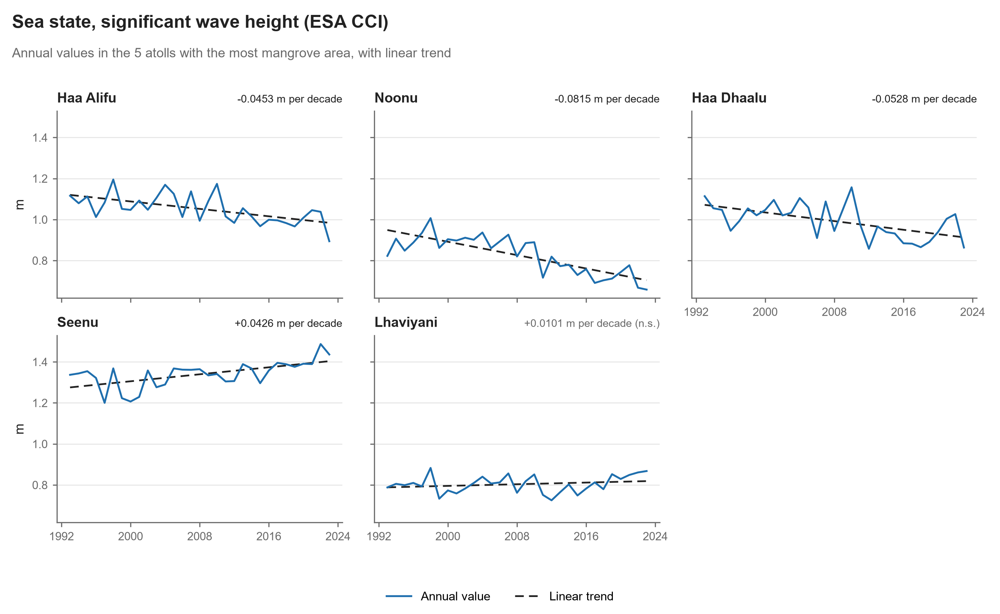

**Figure 9.** Sea state, significant wave height (ESA CCI): annual values in the 5 atolls with the most mangrove area, with linear trend (dashed) and trend per decade.

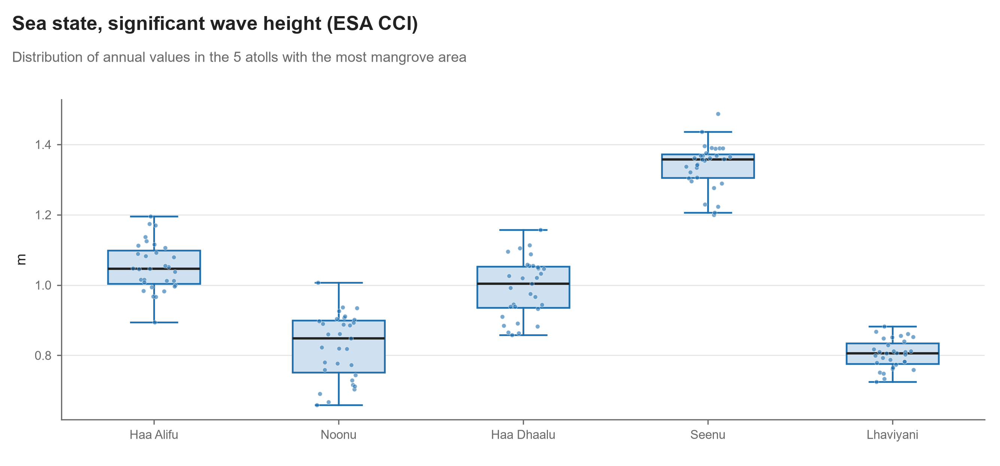

**Figure 10.** Sea state, significant wave height (ESA CCI): distribution of the annual values in the 5 atolls with the most mangrove area. Box: middle half of the years; line: median; whiskers: up to 1.5 times the box; dots: single years.

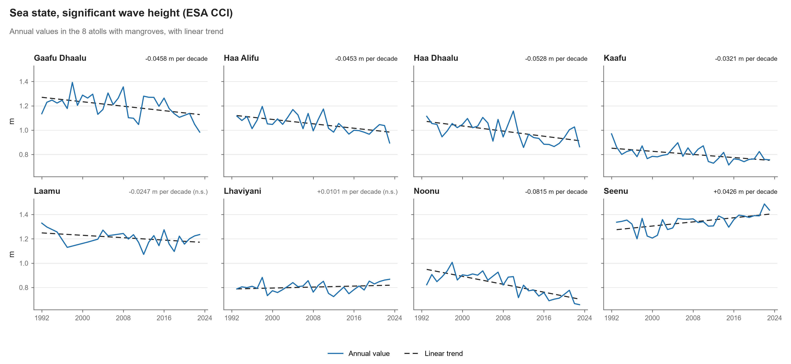

**Figure 11.** Sea state, significant wave height (ESA CCI): annual values in all 8 atolls with mangroves, with linear trend (dashed) and trend per decade.

**Table 3.** Sea state, significant wave height (ESA CCI): mean and linear trend by atoll, largest mangrove area first. Bold: significant (p < 0.05).

| Atoll | Mangrove area (km2) | Period | Mean (m) | Trend (m per decade) | p |
|---|---|---|---|---|---|
| Haa Alifu | 0.339 | 1993 to 2023 | 1.052 | **-0.0453** | < 0.001 |
| Noonu | 0.317 | 1993 to 2023 | 0.8266 | **-0.0815** | < 0.001 |
| Haa Dhaalu | 0.237 | 1993 to 2023 | 0.9923 | **-0.0528** | < 0.001 |
| Seenu | 0.158 | 1993 to 2023 | 1.339 | **+0.0426** | < 0.001 |
| Lhaviyani | 0.104 | 1993 to 2023 | 0.8035 | +0.0101 | 0.226 |
| Laamu | 0.053 | 1992 to 2023 | 1.205 | -0.0247 | 0.071 |
| Gaafu Dhaalu | 0.035 | 1992 to 2023 | 1.199 | **-0.0458** | 0.008 |
| Kaafu | 0.009 | 1992 to 2023 | 0.8018 | **-0.0321** | 0.001 |

## Precipitation (IMERG)

**Figure 12.** Precipitation (IMERG): annual values in the 5 atolls with the most mangrove area, with linear trend (dashed) and trend per decade.

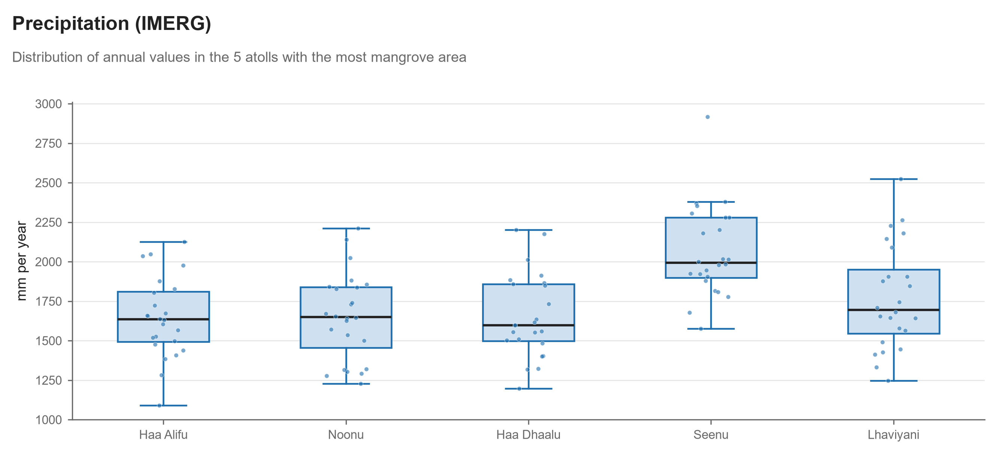

**Figure 13.** Precipitation (IMERG): distribution of the annual values in the 5 atolls with the most mangrove area. Box: middle half of the years; line: median; whiskers: up to 1.5 times the box; dots: single years.

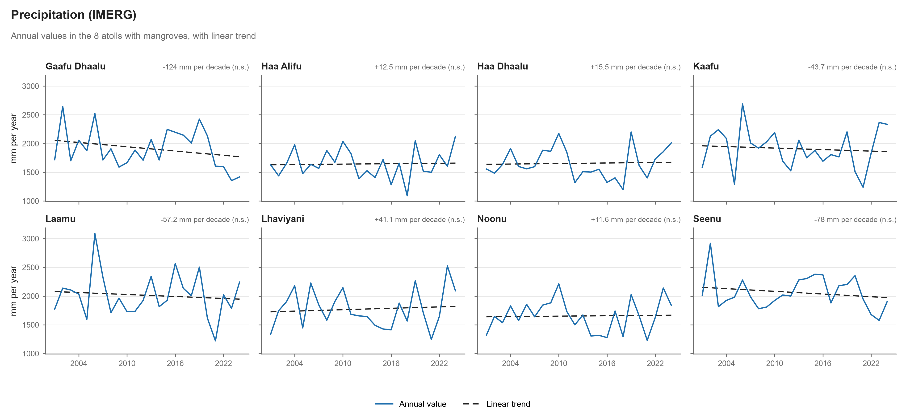

**Figure 14.** Precipitation (IMERG): annual values in all 8 atolls with mangroves, with linear trend (dashed) and trend per decade.

**Table 4.** Precipitation (IMERG): mean and linear trend by atoll, largest mangrove area first. Bold: significant (p < 0.05).

| Atoll | Mangrove area (km2) | Period | Mean (mm per year) | Trend (mm per decade) | p |
|---|---|---|---|---|---|
| Haa Alifu | 0.339 | 2001 to 2024 | 1645 | +12.5 | 0.871 |
| Noonu | 0.317 | 2001 to 2024 | 1653 | +11.6 | 0.890 |
| Haa Dhaalu | 0.237 | 2001 to 2024 | 1656 | +15.5 | 0.848 |
| Seenu | 0.158 | 2001 to 2024 | 2062 | -78 | 0.372 |
| Lhaviyani | 0.104 | 2001 to 2024 | 1772 | +41.1 | 0.684 |
| Laamu | 0.053 | 2001 to 2024 | 2012 | -57.2 | 0.623 |
| Gaafu Dhaalu | 0.035 | 2001 to 2024 | 1913 | -124 | 0.220 |
| Kaafu | 0.009 | 2001 to 2024 | 1910 | -43.7 | 0.681 |

## Air temperature, daily mean (CHELSA)

**Figure 15.** Air temperature, daily mean (CHELSA): annual values in the 5 atolls with the most mangrove area, with linear trend (dashed) and trend per decade.

**Figure 16.** Air temperature, daily mean (CHELSA): distribution of the annual values in the 5 atolls with the most mangrove area. Box: middle half of the years; line: median; whiskers: up to 1.5 times the box; dots: single years.

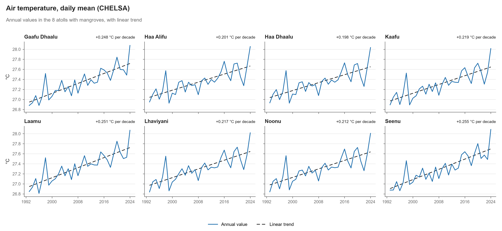

**Figure 17.** Air temperature, daily mean (CHELSA): annual values in all 8 atolls with mangroves, with linear trend (dashed) and trend per decade.

**Table 5.** Air temperature, daily mean (CHELSA): mean and linear trend by atoll, largest mangrove area first. Bold: significant (p < 0.05).

| Atoll | Mangrove area (km2) | Period | Mean (°C) | Trend (°C per decade) | p |
|---|---|---|---|---|---|
| Haa Alifu | 0.339 | 1993 to 2024 | 27.35 | **+0.201** | < 0.001 |
| Noonu | 0.317 | 1993 to 2024 | 27.31 | **+0.212** | < 0.001 |
| Haa Dhaalu | 0.237 | 1993 to 2024 | 27.34 | **+0.198** | < 0.001 |
| Seenu | 0.158 | 1993 to 2024 | 27.3 | **+0.255** | < 0.001 |
| Lhaviyani | 0.104 | 1993 to 2024 | 27.31 | **+0.217** | < 0.001 |
| Laamu | 0.053 | 1993 to 2024 | 27.33 | **+0.251** | < 0.001 |
| Gaafu Dhaalu | 0.035 | 1993 to 2024 | 27.33 | **+0.248** | < 0.001 |
| Kaafu | 0.009 | 1993 to 2024 | 27.31 | **+0.219** | < 0.001 |

## Air temperature, daily maximum (CHELSA)

**Figure 18.** Air temperature, daily maximum (CHELSA): annual values in the 5 atolls with the most mangrove area, with linear trend (dashed) and trend per decade.

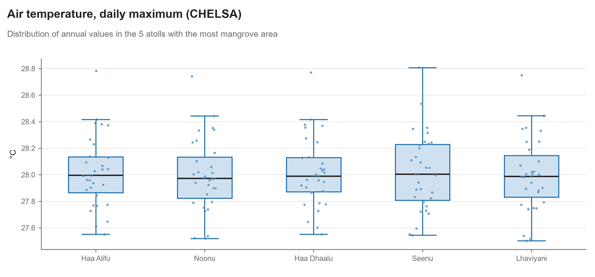

**Figure 19.** Air temperature, daily maximum (CHELSA): distribution of the annual values in the 5 atolls with the most mangrove area. Box: middle half of the years; line: median; whiskers: up to 1.5 times the box; dots: single years.

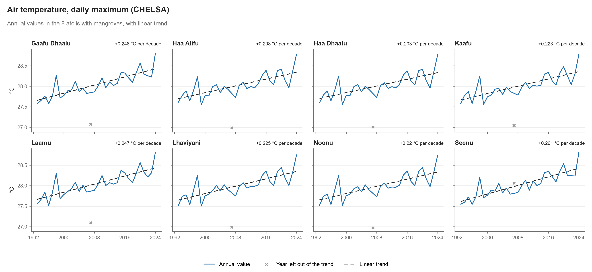

**Figure 20.** Air temperature, daily maximum (CHELSA): annual values in all 8 atolls with mangroves, with linear trend (dashed) and trend per decade.

**Table 6.** Air temperature, daily maximum (CHELSA): mean and linear trend by atoll, largest mangrove area first. Bold: significant (p < 0.05).

| Atoll | Mangrove area (km2) | Period | Mean (°C) | Trend (°C per decade) | p |
|---|---|---|---|---|---|
| Haa Alifu | 0.339 | 1993 to 2024 | 28.02 | **+0.208** | < 0.001 |
| Noonu | 0.317 | 1993 to 2024 | 27.99 | **+0.22** | < 0.001 |
| Haa Dhaalu | 0.237 | 1993 to 2024 | 28.02 | **+0.203** | < 0.001 |
| Seenu | 0.158 | 1993 to 2024 | 28.02 | **+0.261** | < 0.001 |
| Lhaviyani | 0.104 | 1993 to 2024 | 28 | **+0.225** | < 0.001 |
| Laamu | 0.053 | 1993 to 2024 | 28.05 | **+0.247** | < 0.001 |
| Gaafu Dhaalu | 0.035 | 1993 to 2024 | 28.04 | **+0.248** | < 0.001 |
| Kaafu | 0.009 | 1993 to 2024 | 28.01 | **+0.223** | < 0.001 |

Years left out of the trends: 2007.
