# iClimateAction WP3, Task 3.2: Nature-based Solutions and Ecosystems Demonstrator

## Condition indicators

Condition indicators of the mangroves of the Maldives, following the SEEA Ecosystem Accounting (SEEA EA) framework. Each variable is converted to a condition indicator between 0 (lowest condition) and 1 (reference condition). The condition account compares the opening and the closing year, and condition classes (good, intermediate, poor, very poor) follow thresholds from the literature.

| Indicator | Unit | Level | Opening | Closing | Good | Intermediate | Poor | Very poor |
|---|---|---|---|---|---|---|---|---|
| NDVI | unitless | mangrove patches, mean by atoll weighted by area | 2017 | 2024 | 0.66 or more | 0.33 to less than 0.66 | less than 0.33 | n/a |
| Salinity | psu | atoll | 2017 | 2024 | 5 to less than 20 | 20 to less than 34 | 34 to less than 40 | 40 or more |

**Table 1.** Condition indicators and condition classes. The limits of the classes are thresholds from the literature, in the unit of the variable.

**Rescaling.** Following the SEEA EA framework, each variable (V, in its original unit) is converted to a condition indicator (I) between 0 (lowest condition) and 1 (reference condition) by linear rescaling between reference levels (VL, VH). Values beyond the reference levels are set to 0 or 1.

## How to read the figures

- **Rescaled indicator:** the condition indicator, from 0 (lowest condition) to 1 (reference condition), obtained from the variable as described under Rescaling. For indicators measured in the mangrove patches, the atoll value is the mean of the patch values weighted by patch area.
- **Class:** the condition class of the atoll (good, intermediate, poor, very poor), assigned from the value of the variable (not from the rescaled indicator) with the thresholds in Table 1.
- **Change:** the rescaled indicator at closing minus the rescaled indicator at opening. A positive change is an improvement in condition, a negative change a decline.
- **Atolls:** only atolls with mangroves, the one with the largest mangrove area first.
- **Bold:** a significant trend (p < 0.05), in the figures and in the tables of trends.
- **Rounding:** values are rounded to two decimals; the workbooks have the full values.

## NDVI

### Variable by atoll

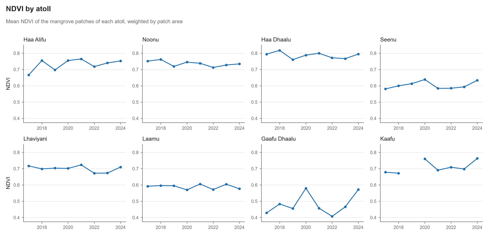

**Figure 1.** Mean NDVI of the mangrove patches of each atoll, weighted by patch area, 2017 to 2024.

### Condition classes

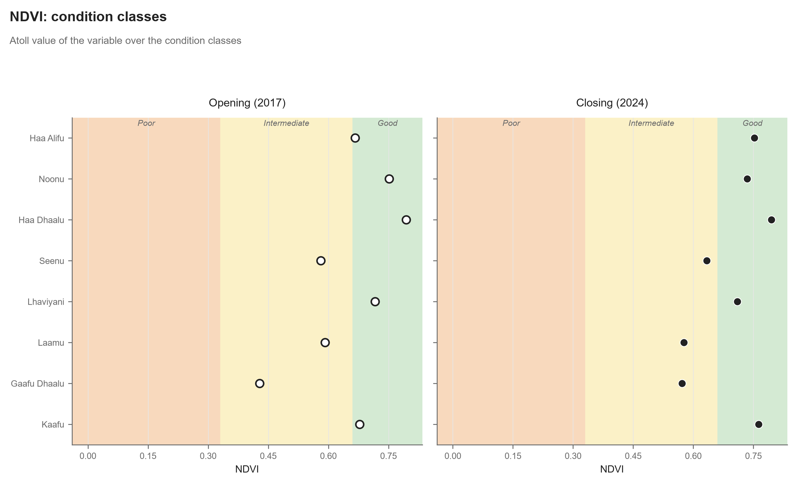

**Figure 2.** Condition classes of NDVI. Atoll value of the variable at opening (2017, open symbol) and closing (2024, filled symbol).

### Rescaled indicator by year

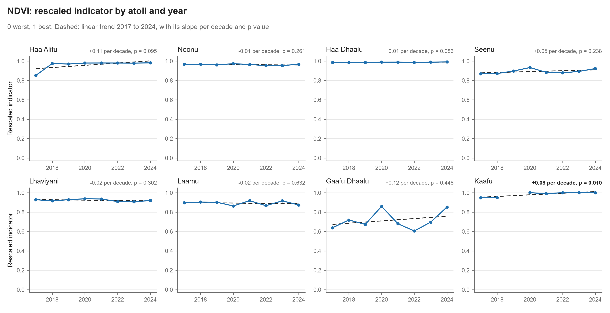

**Figure 3.** Rescaled indicator of NDVI by atoll and year, 2017 to 2024. Dashed line: linear trend (least squares).

| Atoll | Period | Years with data | Trend of the rescaled indicator (per decade) | p |
|---|---|---|---|---|
| Haa Alifu | 2017 to 2024 | 8 | +0.11 | 0.095 |
| Noonu | 2017 to 2024 | 8 | -0.01 | 0.261 |
| Haa Dhaalu | 2017 to 2024 | 8 | +0.01 | 0.086 |
| Seenu | 2017 to 2024 | 8 | +0.05 | 0.238 |
| Lhaviyani | 2017 to 2024 | 8 | -0.02 | 0.302 |
| Laamu | 2017 to 2024 | 8 | -0.02 | 0.632 |
| Gaafu Dhaalu | 2017 to 2024 | 8 | +0.12 | 0.448 |
| Kaafu | 2017 to 2024 | 7 | **+0.08** | 0.010 |

**Table 2.** Linear trend of the rescaled indicator of NDVI. n/a: fewer than 6 years with data. Years without data: Kaafu (2019).

### Condition account

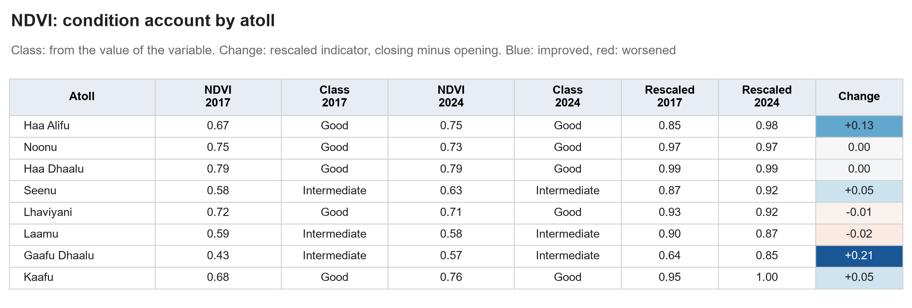

**Table 3.** Condition account of NDVI by atoll, 2017 and 2024. Class: from the value of the variable. Change: rescaled indicator at closing minus at opening.

### Change in condition

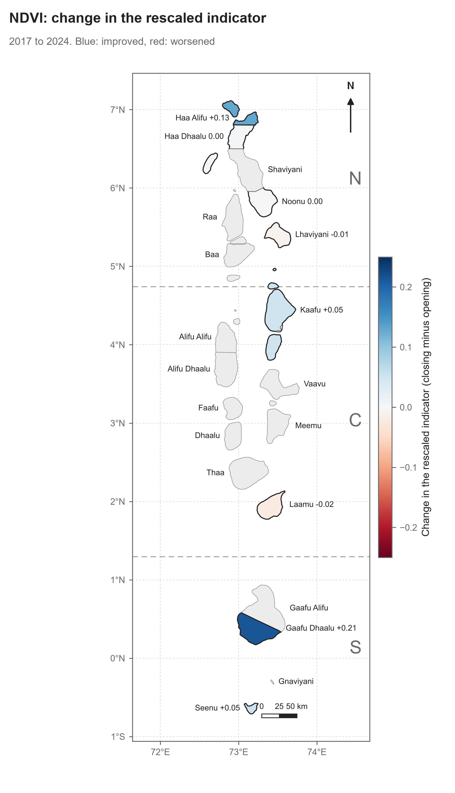

**Figure 4.** Change in the rescaled indicator of NDVI between 2017 and 2024. Blue: improved; red: worsened; grey: atolls without mangroves. The scale is centred on zero.

## Salinity

### Variable by atoll

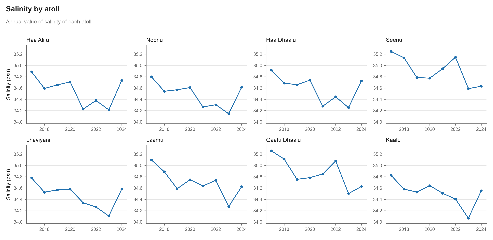

**Figure 5.** Annual value of salinity of each atoll, 2017 to 2024.

### Condition classes

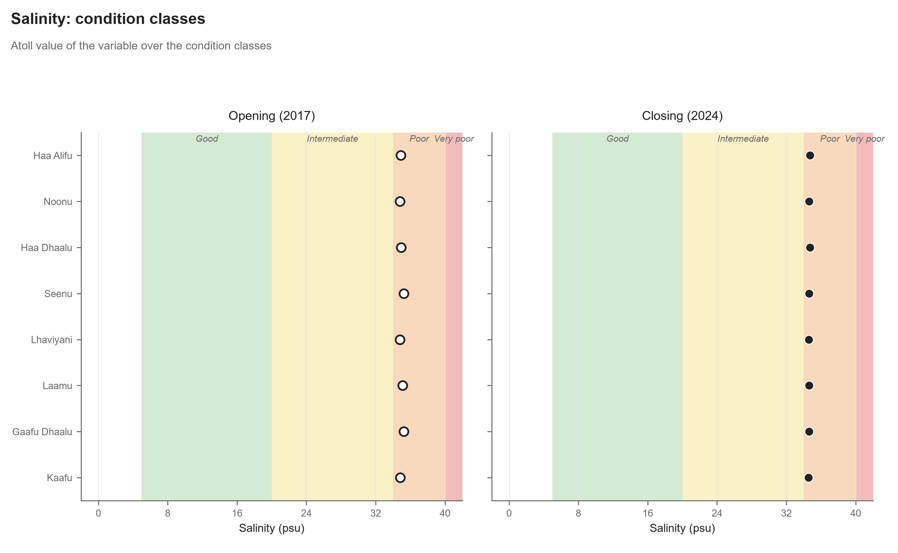

**Figure 6.** Condition classes of Salinity. Atoll value of the variable at opening (2017, open symbol) and closing (2024, filled symbol).

### Rescaled indicator by year

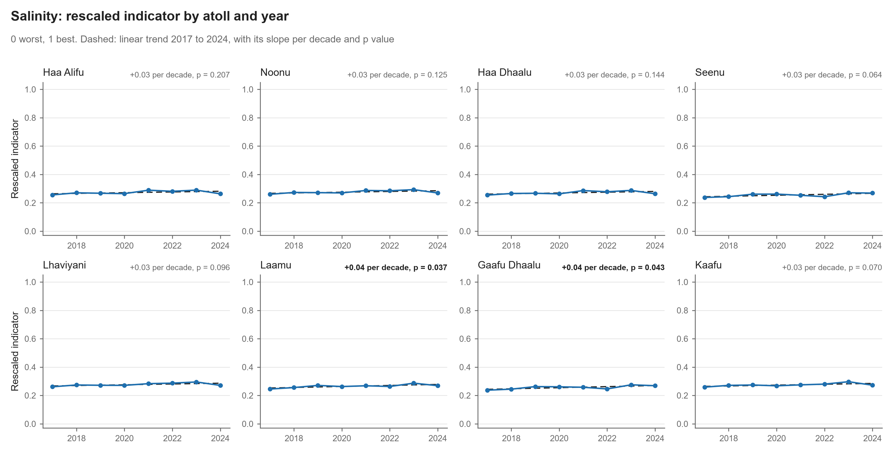

**Figure 7.** Rescaled indicator of Salinity by atoll and year, 2017 to 2024. Dashed line: linear trend (least squares).

| Atoll | Period | Years with data | Trend of the rescaled indicator (per decade) | p |
|---|---|---|---|---|
| Haa Alifu | 2017 to 2024 | 8 | +0.03 | 0.207 |
| Noonu | 2017 to 2024 | 8 | +0.03 | 0.125 |
| Haa Dhaalu | 2017 to 2024 | 8 | +0.03 | 0.144 |
| Seenu | 2017 to 2024 | 8 | +0.03 | 0.064 |
| Lhaviyani | 2017 to 2024 | 8 | +0.03 | 0.096 |
| Laamu | 2017 to 2024 | 8 | **+0.04** | 0.037 |
| Gaafu Dhaalu | 2017 to 2024 | 8 | **+0.04** | 0.043 |
| Kaafu | 2017 to 2024 | 8 | +0.03 | 0.070 |

**Table 4.** Linear trend of the rescaled indicator of Salinity. n/a: fewer than 6 years with data.

### Condition account

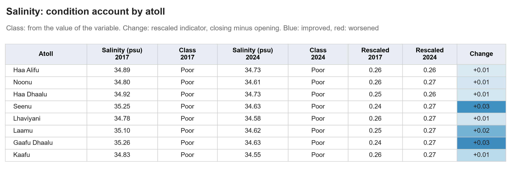

**Table 5.** Condition account of Salinity by atoll, 2017 and 2024. Class: from the value of the variable. Change: rescaled indicator at closing minus at opening.

### Change in condition

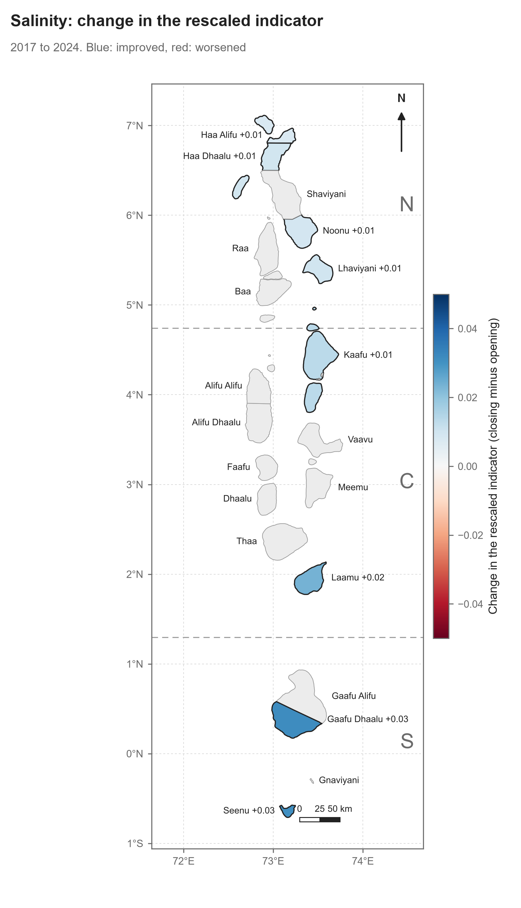

**Figure 8.** Change in the rescaled indicator of Salinity between 2017 and 2024. Blue: improved; red: worsened; grey: atolls without mangroves. The scale is centred on zero.

## Rescaled indicators by atoll

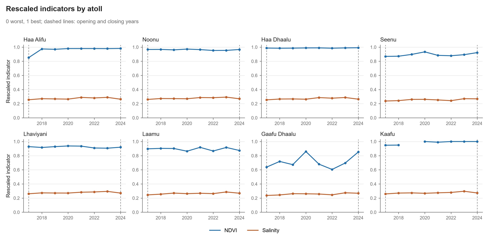

**Figure 9.** Rescaled NDVI and Salinity by atoll and year, 2017 to 2024. Dashed lines: opening and closing years.

## Indicators and ECVs (exploratory analysis)

This section explores whether the annual variation of each condition indicator is associated with Essential Climate Variables (ECVs) that act on mangroves, 2017 to 2024. Each atoll is analysed separately, with the original values of the variable and of the ECV, and then all atolls (differences from the atoll mean). Statistics: Pearson r with its 95% confidence interval and a permutation p value (adjusted for multiple tests with the Holm method), Spearman rho, Kendall tau and the slope of a least squares line. r detrended: r after removing the linear trend of both series. r lag 1: r with the ECV of the previous year. Expected: expected sign of the association. Results for all atolls are in indicators_vs_ecv.xlsx.

### NDVI

#### Time series

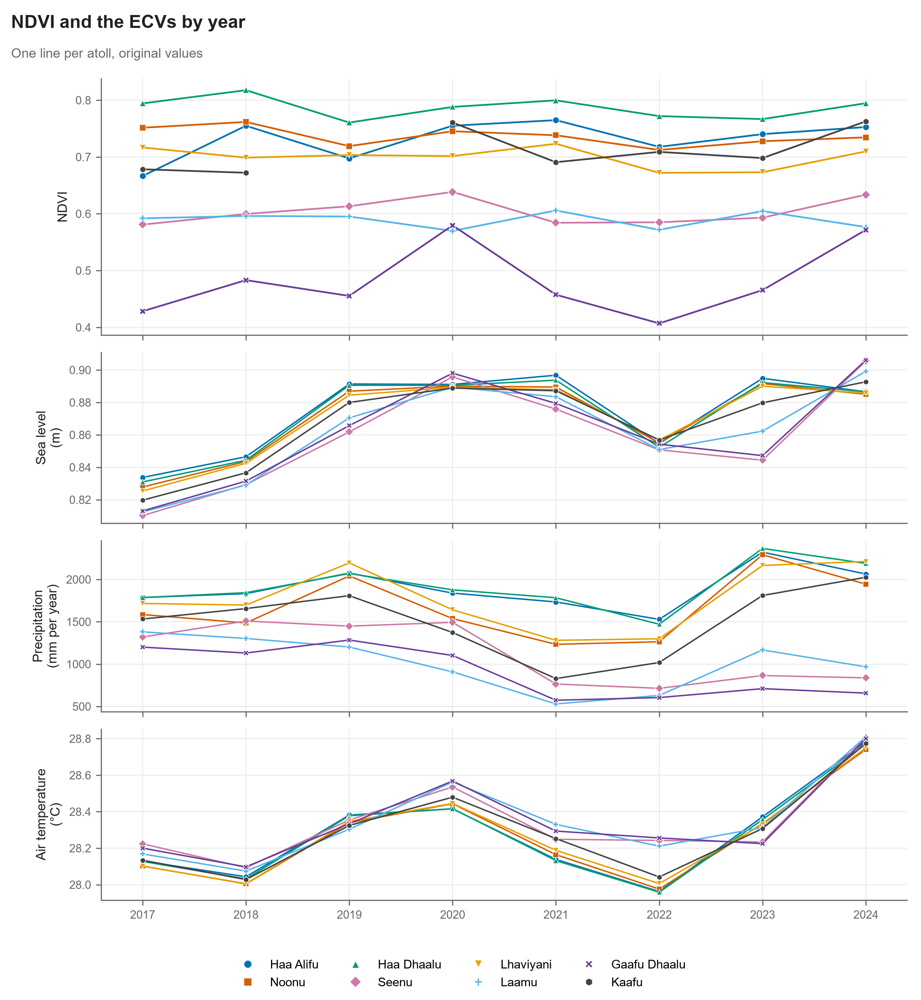

**Figure 10.** Visual comparison of NDVI (top) and the ECVs (below) by year. One line per atoll, original values.

#### By atoll

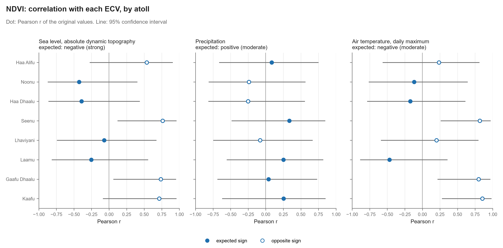

**Figure 11.** Pearson r of NDVI with each ECV in each atoll, with its 95% confidence interval. A filled dot has the expected sign.

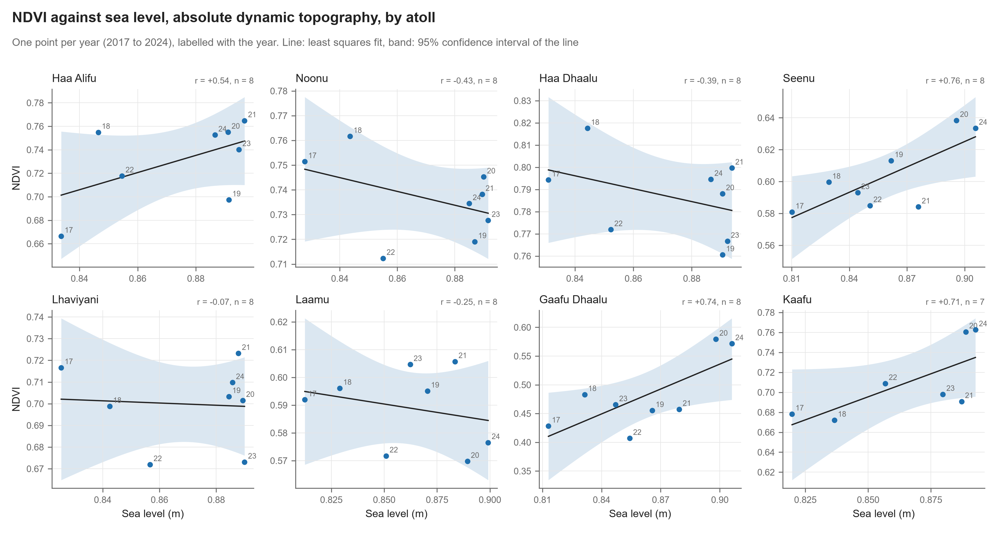

**Figure 12.** NDVI against sea level, absolute dynamic topography (m) in each atoll, original values. Labels: year. Line: least squares fit with its 95% confidence band. A bold r marks an adjusted p < 0.05.

| Atoll | n | r (95% CI) | rho | tau | Slope (95% CI) | p (perm.) | p (Holm) | r detrended | r lag 1 |
|---|---|---|---|---|---|---|---|---|---|
| Haa Alifu | 8 | +0.54 (-0.27 to +0.90) | +0.45 | +0.36 | +0.019 (-0.011 to +0.05) | 0.178 | 1.000 | +0.34 | +0.28 |
| Noonu | 8 | -0.43 (-0.87 to +0.40) | -0.33 | -0.14 | -0.0074 (-0.023 to +0.0083) | 0.290 | 1.000 | -0.12 | -0.32 |
| Haa Dhaalu | 8 | -0.39 (-0.86 to +0.43) | -0.29 | -0.21 | -0.0077 (-0.026 to +0.01) | 0.334 | 1.000 | -0.27 | -0.04 |
| Seenu | 8 | +0.76 (+0.12 to +0.95) | +0.64 | +0.43 | +0.014 (+0.0021 to +0.026) | 0.031 | 0.659 | +0.80 | -0.32 |
| Lhaviyani | 8 | -0.07 (-0.74 to +0.67) | -0.10 | -0.07 | -0.0014 (-0.021 to +0.018) | 0.894 | 1.000 | +0.27 | +0.10 |

**Table 6.** NDVI and sea level, absolute dynamic topography: the 5 atolls with the largest mangrove area. Slope: change in NDVI per standard deviation of the ECV (0.0266 m).

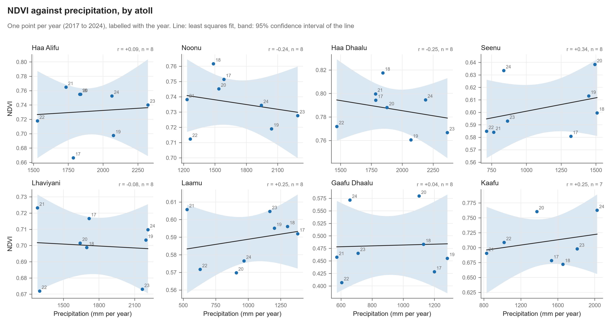

**Figure 13.** NDVI against precipitation (mm per year) in each atoll, original values. Labels: year. Line: least squares fit with its 95% confidence band. A bold r marks an adjusted p < 0.05.

| Atoll | n | r (95% CI) | rho | tau | Slope (95% CI) | p (perm.) | p (Holm) | r detrended | r lag 1 |
|---|---|---|---|---|---|---|---|---|---|
| Haa Alifu | 8 | +0.09 (-0.66 to +0.75) | -0.12 | -0.14 | +0.0038 (-0.04 to +0.048) | 0.832 | 1.000 | -0.09 | +0.65 |
| Noonu | 8 | -0.24 (-0.81 to +0.56) | -0.24 | -0.21 | -0.0033 (-0.017 to +0.01) | 0.561 | 1.000 | -0.09 | +0.27 |
| Haa Dhaalu | 8 | -0.25 (-0.81 to +0.55) | -0.33 | -0.21 | -0.0055 (-0.027 to +0.016) | 0.553 | 1.000 | -0.15 | +0.19 |
| Seenu | 8 | +0.34 (-0.48 to +0.84) | +0.45 | +0.29 | +0.0068 (-0.012 to +0.026) | 0.389 | 1.000 | +0.90 | +0.07 |
| Lhaviyani | 8 | -0.08 (-0.74 to +0.66) | +0.05 | +0.07 | -0.0013 (-0.017 to +0.014) | 0.847 | 1.000 | 0.00 | +0.51 |

**Table 7.** NDVI and precipitation: the 5 atolls with the largest mangrove area. Slope: change in NDVI per standard deviation of the ECV (317 mm per year).

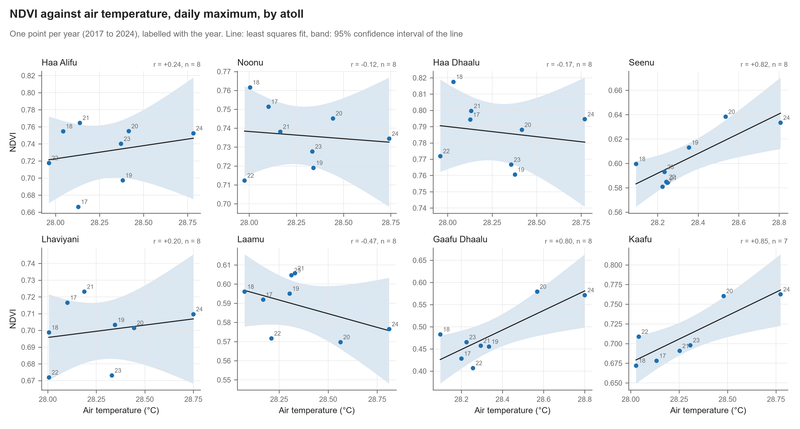

**Figure 14.** NDVI against air temperature, daily maximum (°C) in each atoll, original values. Labels: year. Line: least squares fit with its 95% confidence band. A bold r marks an adjusted p < 0.05.

| Atoll | n | r (95% CI) | rho | tau | Slope (95% CI) | p (perm.) | p (Holm) | r detrended | r lag 1 |
|---|---|---|---|---|---|---|---|---|---|
| Haa Alifu | 8 | +0.24 (-0.56 to +0.81) | +0.21 | +0.14 | +0.0072 (-0.022 to +0.037) | 0.563 | 1.000 | -0.04 | +0.12 |
| Noonu | 8 | -0.12 (-0.76 to +0.64) | -0.07 | -0.14 | -0.0018 (-0.017 to +0.013) | 0.783 | 1.000 | +0.26 | +0.37 |
| Haa Dhaalu | 8 | -0.17 (-0.78 to +0.61) | -0.19 | -0.14 | -0.0029 (-0.02 to +0.014) | 0.694 | 1.000 | -0.01 | +0.57 |
| Seenu | 8 | +0.82 (+0.26 to +0.97) | +0.64 | +0.43 | +0.019 (+0.0056 to +0.033) | 0.015 | 0.352 | +0.83 | -0.29 |
| Lhaviyani | 8 | +0.20 (-0.59 to +0.79) | +0.29 | +0.21 | +0.0035 (-0.014 to +0.02) | 0.639 | 1.000 | +0.55 | +0.67 |

**Table 8.** NDVI and air temperature, daily maximum: the 5 atolls with the largest mangrove area. Slope: change in NDVI per standard deviation of the ECV (0.235 °C).

#### All atolls

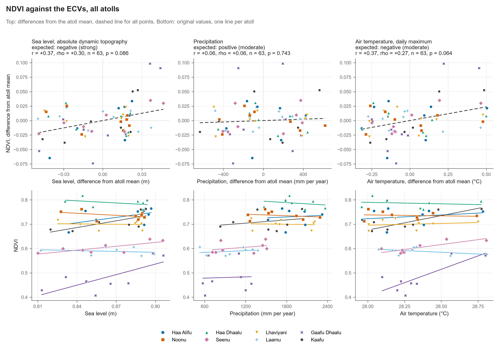

**Figure 15.** NDVI against the ECVs, all atolls. Top: differences from the atoll mean, dashed line for all points. Bottom: original values, one line for each atoll.

| ECV | Expected | n | r | rho | p (year permutation) | Atolls with the expected sign | Median r of the atolls |
|---|---|---|---|---|---|---|---|
| Sea level, absolute dynamic topography | negative (strong) | 63 | +0.37 | +0.30 | 0.086 | 4 of 8 | +0.23 |
| Precipitation | positive (moderate) | 63 | +0.06 | +0.06 | 0.743 | 5 of 8 | +0.06 |
| Air temperature, daily maximum | negative (moderate) | 63 | +0.37 | +0.27 | 0.064 | 3 of 8 | +0.22 |

**Table 9.** Correlation of NDVI with each ECV, all atolls (differences from the atoll mean).

### Salinity

#### Time series

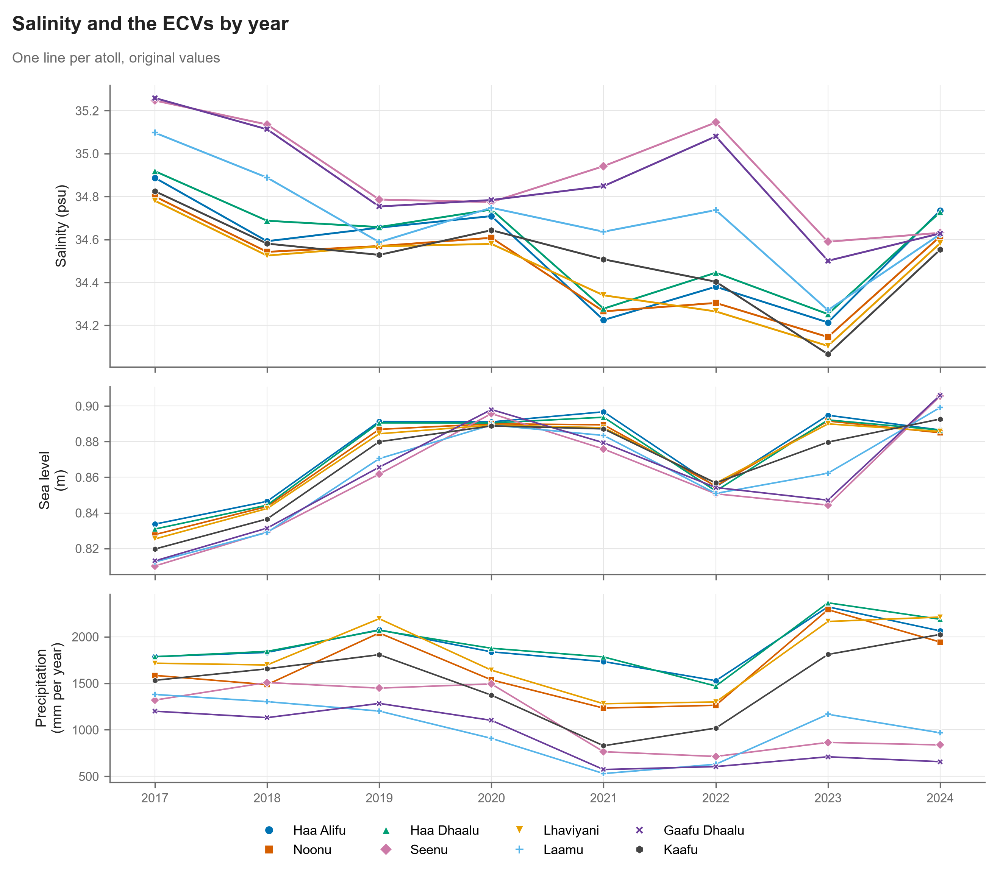

**Figure 16.** Visual comparison of Salinity (top) and the ECVs (below) by year. One line per atoll, original values.

#### By atoll

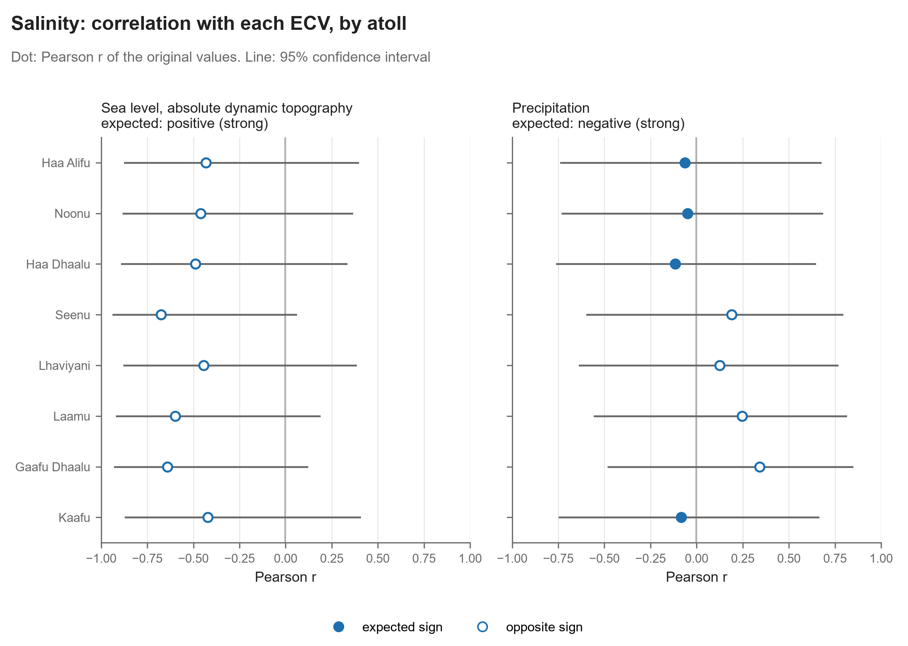

**Figure 17.** Pearson r of Salinity with each ECV in each atoll, with its 95% confidence interval. A filled dot has the expected sign.

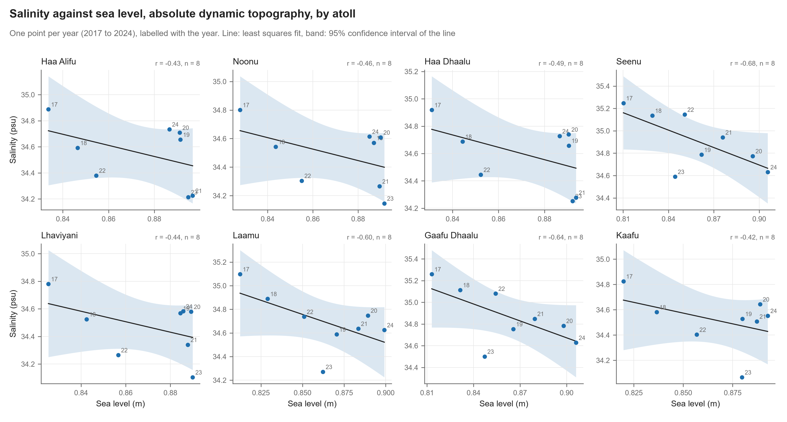

**Figure 18.** Salinity (psu) against sea level, absolute dynamic topography (m) in each atoll, original values. Labels: year. Line: least squares fit with its 95% confidence band. A bold r marks an adjusted p < 0.05.

| Atoll | n | r (95% CI) | rho | tau | Slope (95% CI) | p (perm.) | p (Holm) | r detrended | r lag 1 |
|---|---|---|---|---|---|---|---|---|---|
| Haa Alifu | 8 | -0.43 (-0.87 to +0.39) | -0.62 | -0.50 | -0.11 (-0.35 to +0.12) | 0.288 | 1.000 | -0.20 | -0.11 |
| Noonu | 8 | -0.46 (-0.88 to +0.36) | -0.52 | -0.43 | -0.11 (-0.31 to +0.098) | 0.242 | 1.000 | -0.14 | -0.14 |
| Haa Dhaalu | 8 | -0.49 (-0.89 to +0.33) | -0.69 | -0.50 | -0.12 (-0.33 to +0.094) | 0.217 | 1.000 | -0.23 | -0.14 |
| Seenu | 8 | -0.68 (-0.94 to +0.06) | -0.57 | -0.50 | -0.14 (-0.29 to +0.013) | 0.072 | 1.000 | -0.44 | +0.08 |
| Lhaviyani | 8 | -0.44 (-0.87 to +0.38) | -0.40 | -0.29 | -0.1 (-0.3 to +0.1) | 0.259 | 1.000 | -0.05 | -0.15 |

**Table 10.** Salinity and sea level, absolute dynamic topography: the 5 atolls with the largest mangrove area. Slope: change in Salinity (psu) per standard deviation of the ECV (0.0264 m).

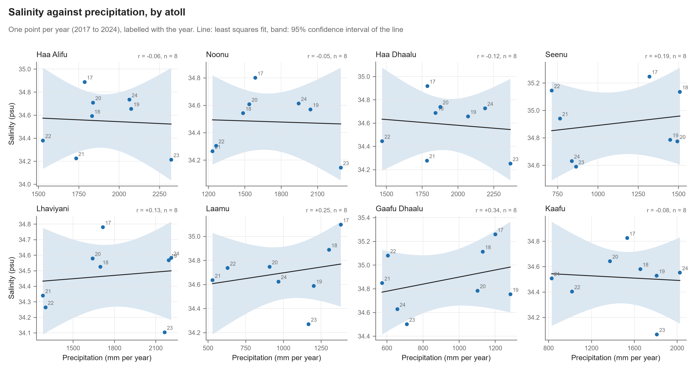

**Figure 19.** Salinity (psu) against precipitation (mm per year) in each atoll, original values. Labels: year. Line: least squares fit with its 95% confidence band. A bold r marks an adjusted p < 0.05.

| Atoll | n | r (95% CI) | rho | tau | Slope (95% CI) | p (perm.) | p (Holm) | r detrended | r lag 1 |
|---|---|---|---|---|---|---|---|---|---|
| Haa Alifu | 8 | -0.06 (-0.74 to +0.67) | 0.00 | 0.00 | -0.02 (-0.34 to +0.3) | 0.885 | 1.000 | +0.11 | +0.11 |
| Noonu | 8 | -0.05 (-0.73 to +0.68) | +0.17 | +0.21 | -0.0089 (-0.19 to +0.17) | 0.902 | 1.000 | +0.16 | +0.42 |
| Haa Dhaalu | 8 | -0.12 (-0.76 to +0.64) | -0.05 | -0.07 | -0.032 (-0.3 to +0.24) | 0.780 | 1.000 | +0.12 | +0.14 |
| Seenu | 8 | +0.19 (-0.59 to +0.79) | -0.05 | -0.07 | +0.043 (-0.18 to +0.26) | 0.632 | 1.000 | -0.75 | +0.30 |
| Lhaviyani | 8 | +0.13 (-0.64 to +0.76) | +0.38 | +0.29 | +0.023 (-0.16 to +0.2) | 0.753 | 1.000 | +0.34 | +0.55 |

**Table 11.** Salinity and precipitation: the 5 atolls with the largest mangrove area. Slope: change in Salinity (psu) per standard deviation of the ECV (317 mm per year).

#### All atolls

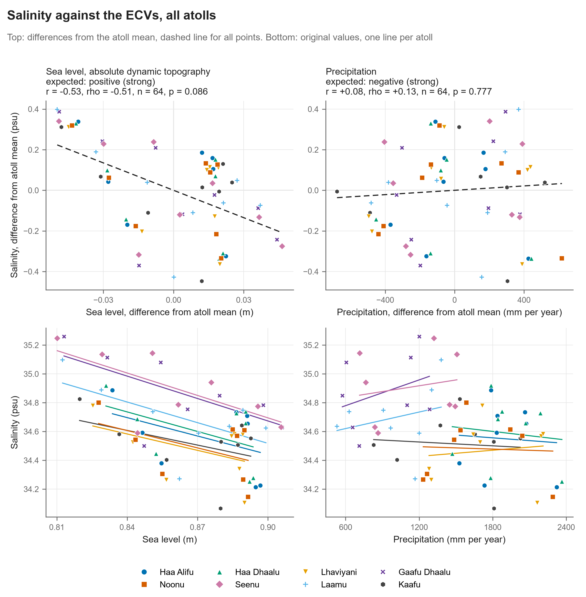

**Figure 20.** Salinity against the ECVs, all atolls. Top: differences from the atoll mean, dashed line for all points. Bottom: original values, one line for each atoll.

| ECV | Expected | n | r | rho | p (year permutation) | Atolls with the expected sign | Median r of the atolls |
|---|---|---|---|---|---|---|---|
| Sea level, absolute dynamic topography | positive (strong) | 64 | -0.53 | -0.51 | 0.086 | 0 of 8 | -0.48 |
| Precipitation | negative (strong) | 64 | +0.08 | +0.13 | 0.777 | 4 of 8 | +0.04 |

**Table 12.** Correlation of Salinity with each ECV, all atolls (differences from the atoll mean).

## Files for download

- [indicators_account.xlsx](indicators_account.xlsx): the condition account by atoll, with values, rescaled indicators, classes, patches and, for the patch based indicators, the change using only the patches with data in both years.
- [indicators_annual.xlsx](indicators_annual.xlsx): variable and rescaled indicator of every atoll and year (sheet annual) and the linear trends (sheet trends).
- [indicators_vs_ecv.xlsx](indicators_vs_ecv.xlsx): all tests of each indicator with the ECVs, by atoll (sheet by_atoll) and all atolls (sheet all_atolls).
- [figures/vector](figures/vector): all figures as PDF.
